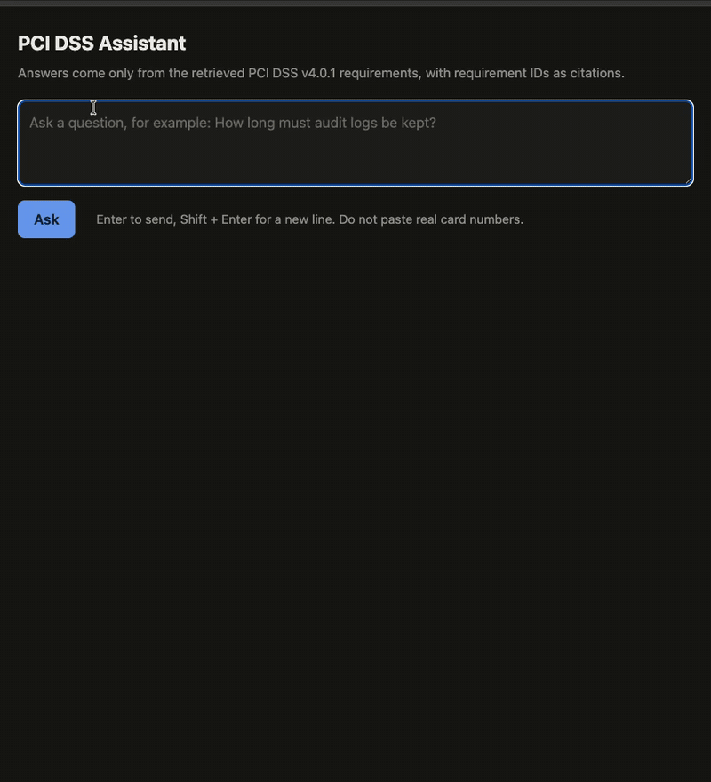

# PCI DSS Assistant

A RAG assistant that retrieves content from PCI DSS v4.0.1 so an LLM can answer compliance questions accurately and consistently.

## Demo



First, an everyday question gets a cited answer. Then a question the standard does not answer gets "could not find" instead of a guess.

## Status

- Done: extraction of the PDF into structured JSON (one file per requirement).
- Done: chunking, keyword / semantic / hybrid retrieval, and a retrieval evaluation set (53 questions plus 14 the standard does not answer).
- Done: query rewriting, where a model rephrases the question in the standard's terminology before searching (53-question evaluation at k=8: 48 fully covered, plain hybrid search 42).
- Done: the evaluation can save a run and compare it with a saved one question by question, and prints a headline score.
- Done: an answer-level check without a judge (`python src/evaluate_answers.py`): does the assistant refuse exactly when the standard has no answer, and does it cite what it should.
- Done: a local web interface (`python src/server.py`) with the same pipeline: each question is its own card, the last 10 stay on the page until it is reloaded, and the sources open in a side panel when you click a citation.
- Done (proof of concept): `ask.py` answers a question from the top 8 retrieved requirements, with citations.
- Planned: a groundedness judge for answers, a measure for partly answerable questions, larger question set. Ideas: stop the rewrite from adding topics the question did not ask about; log live usage (with card numbers masked) to grow the evaluation set.

## Setup

```bash
python3 -m venv .venv
source .venv/bin/activate  # On Windows: .venv\Scripts\activate
pip install -r requirements-dev.txt  # use requirements.txt to skip pytest
```

Place the official PDF at `data/PCI-DSS-v4_0_1.pdf`. The first semantic search downloads the embedding model (`BAAI/bge-base-en-v1.5`) and caches the chunk embeddings under `data/index/`. Answer generation and query rewriting need the `claude` CLI installed and logged in.

## Usage

```bash
# Dump the text blocks of a page (for debugging the extraction)
python src/main.py --page 44 --inspect

# Extract all requirements found in a page range (full document: 42 337)
python src/main.py --pages 90 120 --extract

# Trace every page decision and show tracebacks on failure
python src/main.py --pages 90 120 --extract --verbose
```

```bash
# Chunk the extracted records (data/processed -> data/chunks/chunks-grouped.jsonl)
python src/build_chunks.py

# Compare keyword, semantic and hybrid retrieval on eval/questions.jsonl
python src/evaluate.py --misses hybrid_id

# Also try model-rewritten queries (one model call per question, cached in data/index/rewrites.json)
python src/evaluate.py --methods hybrid_id hybrid_rewrite --k 8

# Keep a run, then after a change list which questions got fixed or broke
python src/evaluate.py --methods hybrid_rewrite --k 8 --save data/index/baseline.json
python src/evaluate.py --methods hybrid_rewrite --k 8 --compare data/index/baseline.json

# Answer a question from the retrieved requirements (--dry-run shows the prompt only; --no-rewrite skips query rewriting)
python src/ask.py "How long must audit logs be kept?"

# Answer every evaluation question and report false refusals, invented answers and missing citations (one model call per new prompt, cached)
python src/evaluate_answers.py

# Same thing in a browser: http://127.0.0.1:8000 (needs the `claude` CLI logged in; listens on this machine only)
python src/server.py
```

Log messages go to stderr and `Saved:` lines go to stdout. Use `--output-dir` to write somewhere other than `data/processed/`.

`--page` and `--pages` use the PDF viewer's 1-based page numbers, not the printed page numbers, which differ because of the front matter.

## Docker

Everything is prepared while the image is built, so the container starts immediately:

```bash
# 1. Save the PDF you downloaded from the PCI SSC document library as data/PCI-DSS-v4_0_1.pdf
# 2. Build once (extracts, chunks and embeds; a few minutes, about 3 GB)
docker build -t pci-assistant .

# 3. Run with your own token (see below)
docker run --rm -p 127.0.0.1:8000:8000 --env-file .env pci-assistant
```

Then open http://127.0.0.1:8000. Keep `127.0.0.1:` in `-p`: without it anyone on your network can spend your token.

**Token.** Answers are generated by the `claude` CLI inside the container, which needs your credentials at run time (they are never part of the image). Run `claude setup-token` in a normal terminal on a machine where you can log in with a browser (it needs a Claude subscription), and put the result in a `.env` file next to the Dockerfile; `.env` is gitignored and excluded from the build context:

```
CLAUDE_CODE_OAUTH_TOKEN=<the token>
```

Use `--env-file` rather than `-e CLAUDE_CODE_OAUTH_TOKEN=...` so the token does not end up in your shell history. Without a subscription, put `ANTHROPIC_API_KEY=<key>` in the same file instead (billed per use). Whoever holds the token spends your quota, so do not share it: everyone who runs the container should create their own.

The image contains the standard's text (the chunks), which PCI SSC copyrights, so use it on your own machine and never push it to a registry; the PDF itself is not kept in the image. The build fails with a message if the PDF is missing. Editing the server or the web page rebuilds in seconds because the preparation layers are cached.

## Output

Extracted records are written to `data/processed/requirement-<id>.json` (chunks go to `data/chunks/`, embeddings to `data/index/`; all gitignored):

- `requirement`: one record per requirement (e.g. `3.7.1`) with the defined requirement, testing procedures, customized approach objective, applicability notes, and guidance.
- `requirement_introduction`: one record per top-level requirement (e.g. `9`) with its title, sections, and overview.

The extraction aborts without writing anything if any page in the selected range fails to parse. Errors name the PDF page, requirement, and column, and suggest the matching `--inspect` command.

## Tests and evaluation

```bash
python -m pytest                          # behavioral tests
python src/evaluate.py --misses hybrid    # retrieval evaluation
```

**Tests** run the CLI as a subprocess against the real PDF, so internals can be refactored freely. They cover four things:
- Extraction correctness: an independent reader (`tests/pdf_oracle.py`, no shared code with `src/`) compares every record, and `test_sampled_expectations.py` holds hand-verified values for tricky pages.
- Structural invariants and clear failures for unsupported page ranges (`test_invariants.py`, `test_cli_failures.py`).
- Chunking, search scoring and the answer pipeline (`test_chunking.py`, `test_evaluate.py`, `test_ask.py`, `test_rewrite.py`). The model call is replaced by a fake `claude` command, so no test calls a model.
- Consistency of the question set with the extracted data (`test_eval_questions.py`).

**Evaluation** (`eval/questions.jsonl`, 53 questions) measures retrieval: for each question, are the expected requirement IDs in the top k results? The report counts questions with all and with at least one expected requirement, overall and per question type. `eval/unanswerable.jsonl` holds questions the standard does not answer, for testing the "could not find" reply.

**What is not in this repository.** The PDF, the extracted JSON, the chunks and the reference ("golden") outputs contain the standard's text, which PCI SSC copyrights, so they are gitignored. Download the PDF yourself (see Setup). Tests that compare against golden files or quoted text skip when those files are absent; everything else, including the independent PDF check, runs. Without the PDF all tests skip.
